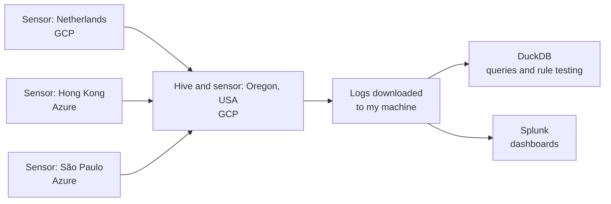
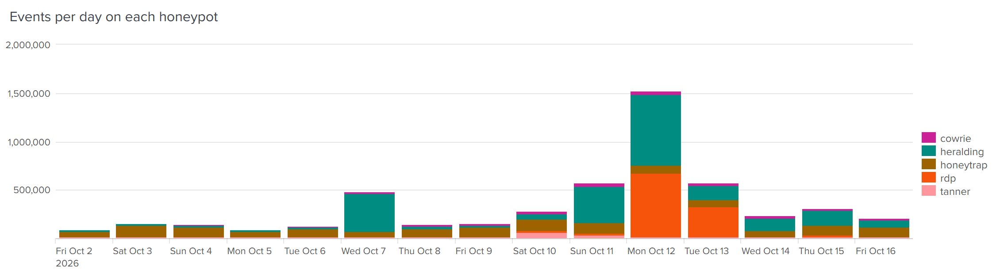
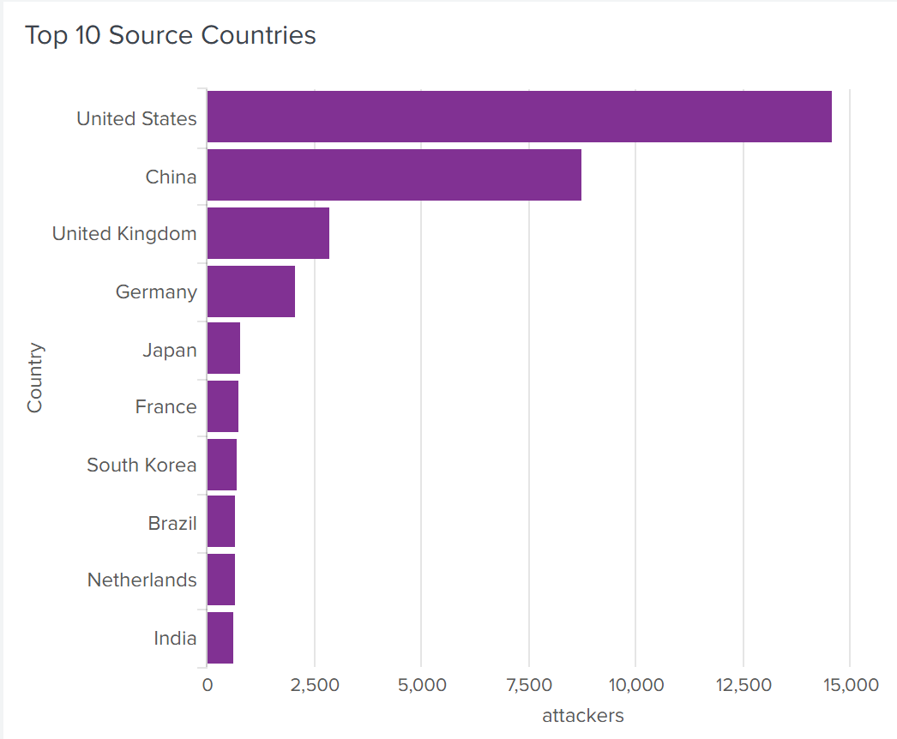
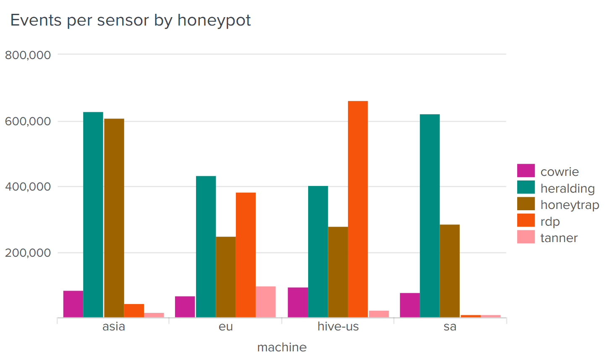
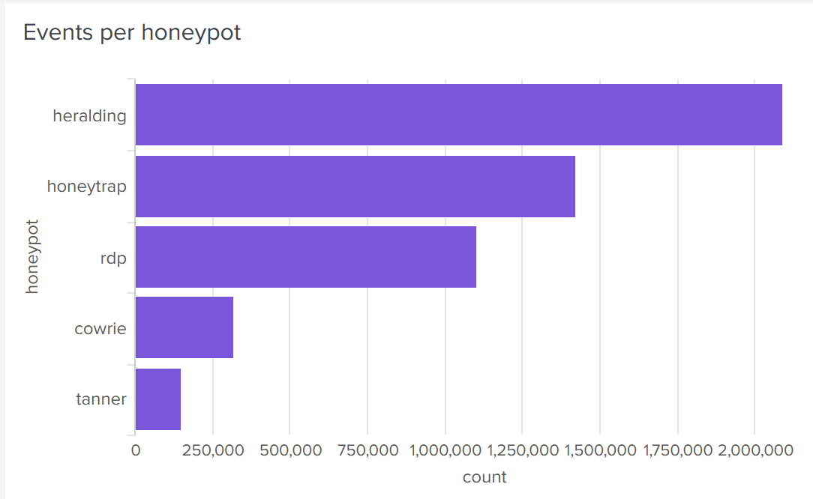
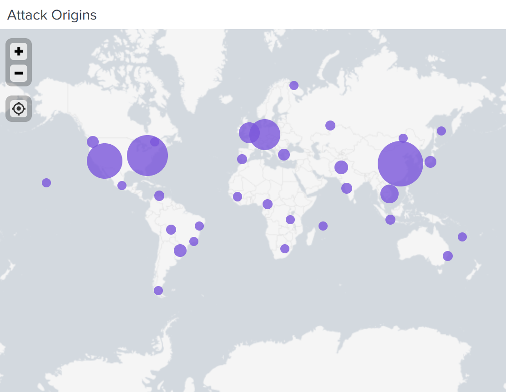
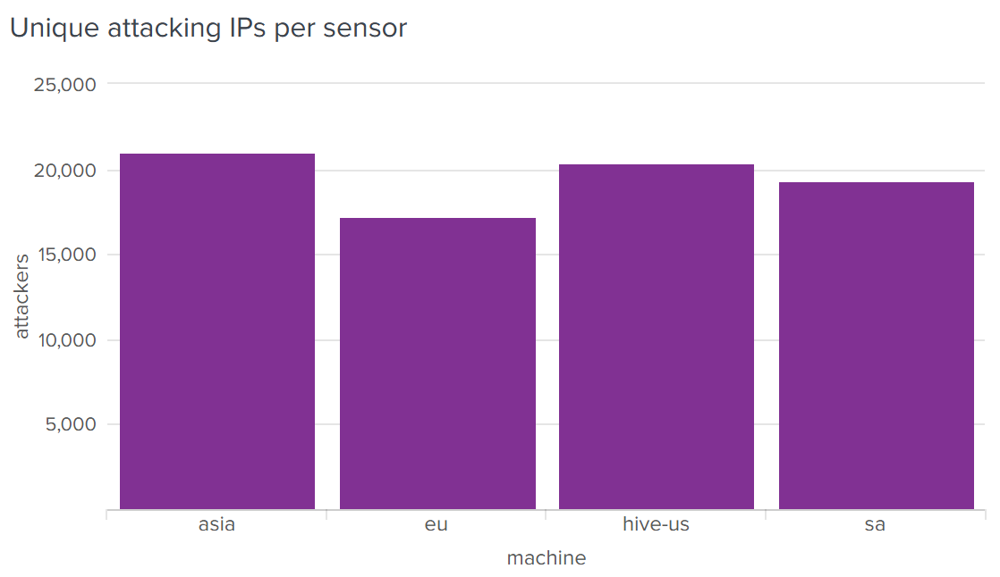
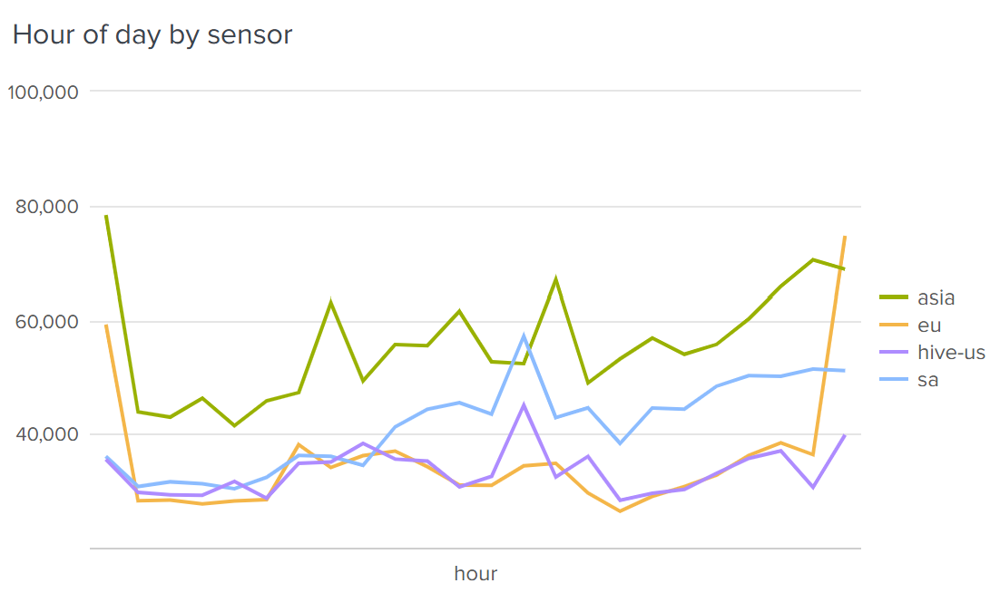

# T-Pot Honeynet Analysis

I deployed a T-Pot honeynet on four cloud machines (a hive and three sensors) across four world regions and captured two weeks of real attacks: 5.08 million events. I then investigated three attack campaigns, mapped them to MITRE ATT&CK, and wrote detection rules on week 1 data. Tested on week 2, the rules caught far more attacks than an IP blocklist.

Fourth-year individual assignment, Network Security Analytics, TU Dublin (2026).

## Research questions

1. What kinds of attacks hit a honeynet, where do they come from, and does the sensor's region matter?
2. Can the activity be grouped by attack, pattern or source?
3. Do detection rules written from week 1 data work on week 2, and do they beat a blocklist of attacker IPs?

## Setup

- **Platform:** T-Pot on four Ubuntu VMs: a hive and a sensor in Oregon (US) on Google Cloud, a sensor in the Netherlands on Google Cloud, and sensors in Hong Kong and São Paulo on Microsoft Azure
- **Collection window:** 2 October 12:00 to 16 October 12:00 GMT, 2026
- **Analysis:** logs loaded into DuckDB for querying, and Splunk for the charts
- **Safety:** I never downloaded malware or uploaded files. I recorded their SHA-256 hashes and looked them up on VirusTotal instead.

## Findings

**5.08 million events in two weeks**, usually 100,000 to 250,000 a day. Four days spiked much higher, peaking at 1.5 million on 12 October. VNC probing drove the spikes, with RDP joining it on the 12th and 13th.

| Honeypot | Events |
|---|---|
| Heralding (VNC and other logins) | ~2.0 million |
| Honeytrap | ~1.4 million |
| RDP | ~1.1 million |
| Cowrie (SSH and Telnet) | ~320,000 |
| Tanner (web) | ~150,000 |

**Where attacks came from:** most unique attacking IPs were in the United States (~14,500) and China (~8,700). By event volume, Germany and the Netherlands ranked much higher, with fewer sources sending far more traffic. Most sources were cloud-hosted addresses, so the country is where the IP is registered, not necessarily where the attacker is.

**Does region matter?** Each sensor saw a similar total, between 1.0 and 1.47 million events, but very different traffic. RDP hit the US and EU sensors hardest. The Hong Kong sensor saw over twice as much Honeytrap activity as the others, and the EU sensor saw the most web requests. None showed a day/night pattern, which fits automated botnets running around the clock.

## Investigations

| Campaign | What happened | Scale | MITRE ATT&CK |
|---|---|---|---|
| **SSH key replacement** | After logging in, the attacker deletes `~/.ssh`, writes their own public key into `authorized_keys` and sets a random password, keeping access even if the password is changed | ~300 IPs, 520 sessions in week 1 and 497 in week 2 | T1098.004 SSH Authorized Keys |
| **BusyBox botnet** | One IP hit all four sensors. It runs `busybox BOTNET` to fingerprint the device, then uses `wget` to fetch `kla.sh`, runs `chmod 777` and executes it. VirusTotal flags the script 32/60 as a Mirai-family downloader, first seen 3 weeks before my collection | 192 sessions in week 1, 1,136 in week 2 | T1059.004 Unix Shell, T1105 Ingress Tool Transfer, T1222.002 Linux File Permissions |
| **PHP-CGI exploit** | Requests use a soft hyphen (`%AD`), which some Windows PHP setups read as `-`, together with `allow_url_include` and `auto_prepend_file=php://input` so the request body runs as code ([CVE-2024-4577](https://labs.watchtowr.com/no-way-php-strikes-again-cve-2024-4577/)) | 95 requests from 38 IPs in week 1, 105 from 45 in week 2 | T1190 Exploit Public-Facing Application |

## Detection rules vs IP blocklist

I wrote each rule from the week 1 data only, then ran it on week 2. As a baseline, I blocked every IP that carried out the same attack in week 1.

| Rule | Caught by rule | Caught by blocklist |
|---|---|---|
| [SSH key replacement](detection-rules/01-ssh-key-replacement.sql) | **497 / 509 (97.6%)** | 93 / 509 (18.3%) |
| [BusyBox botnet](detection-rules/02-busybox-botnet.sql) | 1,099 / 1,136 (96.7%) | **1,136 / 1,136 (100%)** |
| [PHP-CGI CVE-2024-4577](detection-rules/03-php-cgi-cve-2024-4577.sql) | **105 / 257 (40.9%)** | 60 / 257 (23.3%) |

- **SSH key replacement:** the rule matches all four steps (`rm -rf .ssh`, `mkdir .ssh`, `authorized_keys`, `ssh-rsa`), so it still works when the keys, passwords and IPs change. The 12 sessions it missed used a different script.
- **BusyBox botnet:** the blocklist won only because every session came from one IP. The rule would keep working if the IP changed. The 37 sessions it missed skipped the `BOTNET` check and only ran the download.
- **PHP-CGI exploit:** the rule was written for CVE-2024-4577 only. The other requests used a double-encoded hyphen (`%25AD`, 102 requests) or the older CVE-2012-1823 `-d` form (50 requests). This shows behaviour rules need regular updating as attackers change their methods.

This follows Bianco's [Pyramid of Pain](https://detect-respond.blogspot.com/2013/03/the-pyramid-of-pain.html): IPs are easy for an attacker to change, but behaviour is much harder to change.

## Indicators

| Type | Value | Note |
|---|---|---|
| IPv4 | `160.119.66.206` | BusyBox botnet source, hit all four sensors |
| SHA-256 | `39be6853a8204ce6455a373a6ffb4cb4672d4a62d90be69f7d6eeb66cda10b96` | `kla.sh`, Mirai-family downloader ([VirusTotal](https://www.virustotal.com/gui/file/39be6853a8204ce6455a373a6ffb4cb4672d4a62d90be69f7d6eeb66cda10b96)) |

## Limitations

- The EU sensor was offline for 21 hours, and the South American sensor started late.
- RDP timestamps were unreliable, as they appeared to arrive in a batch at midnight.
- A honeypot has no normal users, so false positive rates can't be measured.
- The rule tests use a small part of the full dataset, and some samples are small.

## More charts

| | |
|---|---|
|  |  |
|  |  |

This repository holds no server addresses, credentials or raw logs from my own setup.
